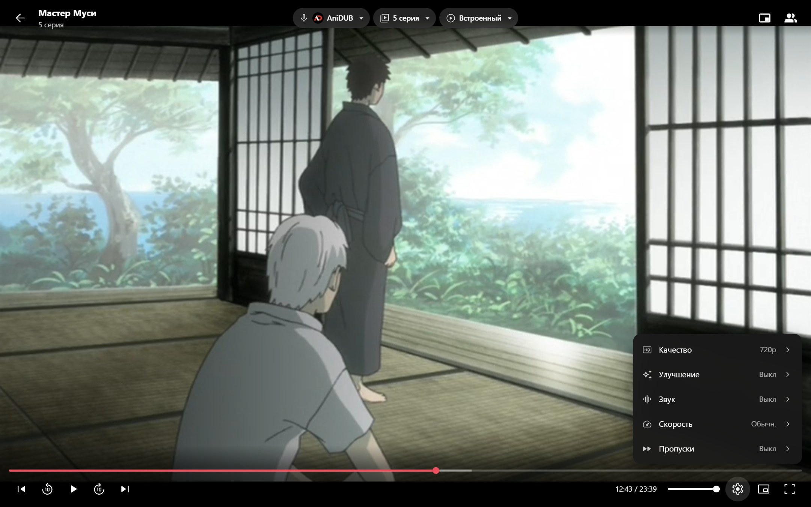
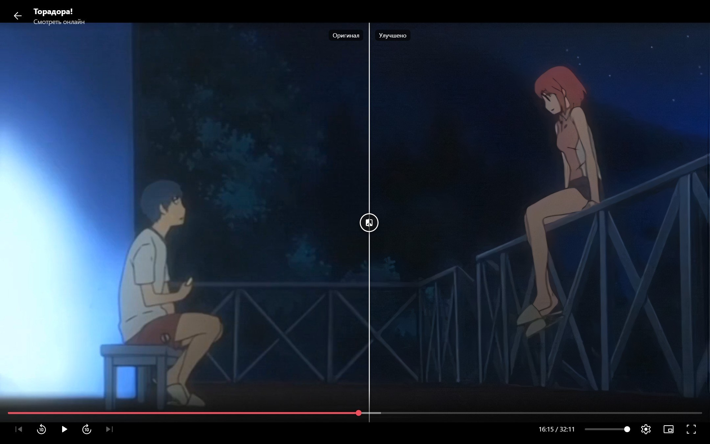
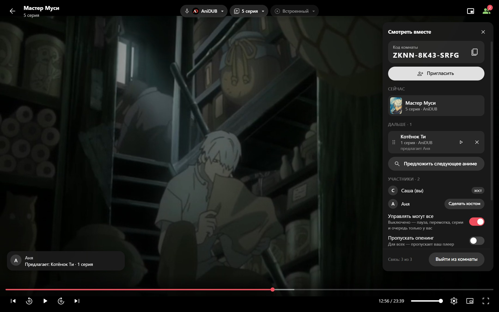
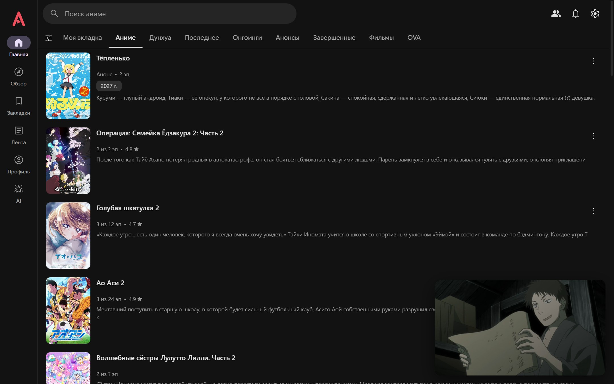

# Anix Desktop

**Неофициальный клиент [Anixart](https://anixart.tv) для Windows, Android и браузера — с AI-помощником на Claude**

[**Скачать**](https://github.com/arigandores/anix-desktop/releases/latest) · [Возможности](#возможности) · [Улучшение картинки](#улучшение-картинки) · [AI-помощник](#ai-помощник) · [Запуск из исходников](docs/TECHNICAL.md#запуск-из-исходников)

Anix Desktop — программа для компьютера, в которой можно смотреть аниме из каталога Anixart. Всё как в приложении
на телефоне: тот же каталог, тот же аккаунт, те же закладки, история и комментарии. Плюс то, чего на телефоне нет:
улучшение картинки нейросетью, совместный просмотр с друзьями, мини-плеер и AI-помощник, который подскажет, что
посмотреть.

> Anix Desktop — независимый проект: он не связан с разработчиками Anixart и не одобрен ими.
> Названия и товарные знаки принадлежат их правообладателям (см. [NOTICE.md](NOTICE.md)).

## Скачать

1. Откройте [страницу последней версии](https://github.com/arigandores/anix-desktop/releases/latest) и скачайте
   файл `AnixDesktop-Setup-….exe` (в разделе **Assets**).
2. Запустите его и следуйте шагам установщика. Права администратора не нужны.
3. Если Windows покажет синее окно «Система Windows защитила ваш компьютер» — нажмите **«Подробнее»** →
   **«Выполнить в любом случае»**. Так бывает со всеми программами без платной цифровой подписи.
4. Откройте Anix Desktop с ярлыка на рабочем столе. Войдите в аккаунт Anixart (или смотрите без входа).

Нужен компьютер с Windows 10 или 11 (64-бит). Программа бесплатная.

**Обновлять вручную не нужно**: когда выйдет новая версия, программа сама покажет, что в ней нового, и обновится
по кнопке «Обновить». Вход и настройки сохранятся.

### На телефон (Android)

1. На телефоне откройте [страницу последней версии](https://github.com/arigandores/anix-desktop/releases/latest) и
   скачайте `Anix-….apk` (раздел **Assets**).
2. Откройте скачанный файл. Если Android спросит, разрешить ли установку из браузера, — разрешите (один раз).
3. Откройте **Anix** и войдите в аккаунт Anixart — те же закладки, история и отметки серий, что на компьютере.

Нужен Android 11 или новее. Всё основное — как на компьютере: каталог, серии, встроенный плеер (с пропуском опенинга,
«картинкой в картинке» при сворачивании), совместный просмотр с теми, кто смотрит на компьютере. Нет улучшения
картинки, AI-помощника и статуса в Discord. Новые версии приложение предлагает само.

## Возможности

### Продолжить с того же места

На странице аниме (снимок выше) — большая кнопка **«Продолжить · 5 серия»**: один клик, и серия идёт с той минуты,
где вы остановились. Залитая часть кнопки показывает, сколько уже просмотрено, справа — сколько осталось. Рядом —
кнопка следующей серии. Досмотрели до титров — кнопка сама предложит следующую серию.

Если вы смотрели на телефоне в Anixart, программа это тоже учтёт и продолжит оттуда.

### Озвучка, источник и плеер — на одном экране

Сверху над списком серий три переключателя: **озвучка** (с поиском по названию), **источник видео** (с качеством —
до 1080p) и **плеер**. Выбор запоминается для каждого аниме. Просмотренные серии отмечены — в любой озвучке.

### Удобный плеер

- **Пропуск опенинга и эндинга** — сам или по кнопке «Пропустить» (где источник видео их отметил).
- **Пропуск филлеров** — серии-вставки, которые не двигают сюжет, можно перескакивать автоматически.
- **Двойной клик** по левому или правому краю — перемотка на 10 секунд; **зажать** — ускорение ×2.
- **Шестерёнка** — качество, скорость, улучшение картинки и звука.
- Озвучку и серию можно сменить прямо в плеере — видео продолжится с того же места.
- Если удобнее свой плеер — можно открывать серии в mpv или VLC (если они установлены).

<b>Горячие клавиши</b> (в английской раскладке)

| Клавиша | Что делает |
|---|---|
| Пробел или K | пауза / продолжить |
| ← / → | назад / вперёд на 5 секунд |
| ↑ / ↓ | громкость |
| F | во весь экран |
| M | без звука |
| N / P | следующая / предыдущая серия |
| S | пропустить опенинг или эндинг |
| I | «Картинка в картинке» |
| U | улучшение картинки вкл / выкл |
| C (удерживать) | показать оригинал без улучшения |
| Esc | закрыть плеер |

### Улучшение картинки

Многие серии выложены в низком качестве, и на большом мониторе картинка мутная. Плеер прямо во время просмотра
делает её чётче с помощью нейросети: линии становятся резкими, «мыло» уходит. На снимке слева — как было,
справа — как стало.

Включается в шестерёнке плеера → «Улучшение». Режим **«Авто»** сам подбирает силу улучшения под серию
и вашу видеокарту — ничего настраивать не нужно.

- Работает на большинстве современных видеокарт.
- На видеокартах **NVIDIA RTX** работает в 2–4 раза быстрее: программа предложит один раз скачать ускорение
  (≈ 93 МБ) кнопкой «Установить». Нужен свежий драйвер NVIDIA — если он устарел, программа подскажет.

### Улучшение звука

Шестерёнка плеера → «Звук», три переключателя:

- **Выравнивать громкость** — тихие реплики громче, взрывы и крики тише. Удобно ночью.
- **Чёткий голос** — голоса громче музыки и шумов.
- **Объёмный звук** — для наушников: звук будто вокруг вас, а не внутри головы.

### Смотреть вместе

Смотрите аниме с друзьями, даже если вы в разных городах. Нажмите **«Смотреть вместе»** на странице аниме или
в плеере — появится комната с кодом. Отправьте друзьям код или ссылку-приглашение кнопкой «Пригласить».

- Пауза, перемотка и смена серии происходят **у всех одновременно**.
- Есть **чат** и **очередь «Дальше»**: каждый может предложить, что смотреть следующим.
- Создатель комнаты может оставить управление только себе.

Каждый смотрит видео у себя, со своим качеством и настройками. Аккаунт Anixart для этого не нужен.

### Мини-плеер и «Картинка в картинке»

Сверните плеер в угол — серия продолжит идти, а вы сможете листать каталог и выбирать, что смотреть дальше.

А **«Картинка в картинке»** (кнопка в плеере или клавиша I) выносит видео в маленькое окно поверх всех программ:
можно смотреть и одновременно работать или сидеть в браузере. В окне есть кнопки следующей серии и перемотки.

### AI-помощник

Вкладка **AI** — чат, в котором можно спросить: «что посмотреть на вечер?», «найди что-то похожее на Мастера
Муси», «собери коллекцию лучших аниме про спорт». Помощник видит ваши списки и оценки, поэтому советует под вас.
По просьбе он сам добавит аниме в закладки, поставит оценку или создаст коллекцию, а ещё запоминает ваши
предпочтения.

Помощник работает на [Claude](https://claude.ai): нужен аккаунт Claude с подпиской Pro или Max (или оплата по API).
Отдельно ничего ставить не нужно — всё уже внутри программы. Всё остальное
в программе работает и без него.

### И ещё

- **Всё из Anixart**: каталог, поиск и фильтры, закладки, лента и каналы, коллекции, комментарии с ответами,
  уведомления о новых сериях, профиль. Вход по логину и паролю, через Google, ВКонтакте, Telegram или Яндекс.
- **Статус в Discord** — друзья увидят, что вы смотрите: аниме, серию и сколько осталось. Включается
  в настройках (по умолчанию выключен), Discord должен быть запущен на этом же компьютере.
- **Настройки по разделам**: тема (тёмная или светлая), качество по умолчанию, скорость, пропуски, плееры.
- **Альтернативное соединение** — если Anixart у вас плохо открывается, в настройках можно включить запасные
  адреса.
- **Версия для браузера** — то же самое, но во вкладке браузера. Для запуска нужен Node.js, подробности —
  в [технической документации](docs/TECHNICAL.md#сборки).

## Частые вопросы

**Это бесплатно?** Да. Программа бесплатная и с открытым кодом. Платный только AI-помощник — точнее, подписка
Claude, если она вам нужна.

**Нужен ли аккаунт Anixart?** Смотреть можно и без него. С аккаунтом появятся закладки, история и комментарии —
общие с приложением на телефоне.

**Безопасно ли это?** Предупреждение Windows при установке появляется потому, что у программы нет платной
цифровой подписи. Весь код открыт и лежит в этом репозитории.

**У меня не NVIDIA — улучшение картинки будет работать?** Да, на большинстве видеокарт. Ускорение для NVIDIA RTX —
просто быстрее.

**Есть версия для Mac, Linux или телефона?** Программа — для Windows. На телефоне есть официальное приложение
Anixart. Версия для браузера запускается через Node.js, но на других системах её не проверяли.

**Нашёл ошибку или есть идея.** Напишите в [Issues](https://github.com/arigandores/anix-desktop/issues).

## Для разработчиков

Как запустить из исходников, какие нужны ключи, как всё устроено внутри, тесты и сборка релиза —
в **[технической документации](docs/TECHNICAL.md)**.

## Star History

<a href="https://star-history.com/#arigandores/anix-desktop&Date">
  <picture>
    <source media="(prefers-color-scheme: dark)" srcset="https://api.star-history.com/svg?repos=arigandores/anix-desktop&type=Date&theme=dark">
    
  </picture>
</a>

## Лицензия

Код — [MIT](LICENSE). Шрифт, библиотеки и товарные знаки — см. [NOTICE.md](NOTICE.md).

Модели улучшения картинки — по лицензиям своих авторов: ArtCNN — MIT, AnimeJaNai — CC BY-NC-SA 4.0,
AniSD — CC BY-NC 4.0. Последние две — только для некоммерческого использования: если вы используете код или
сборки в коммерческих целях, уберите эти модели из `public/models` (ArtCNN можно оставить) или договоритесь
с их авторами.
