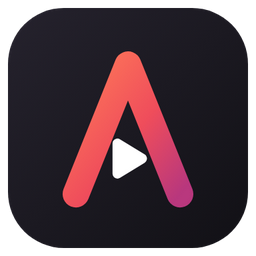
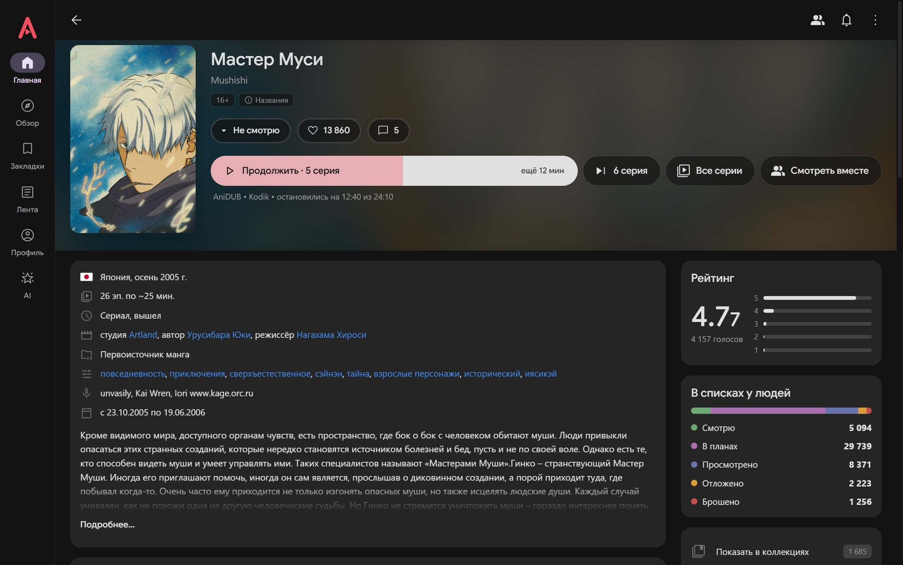
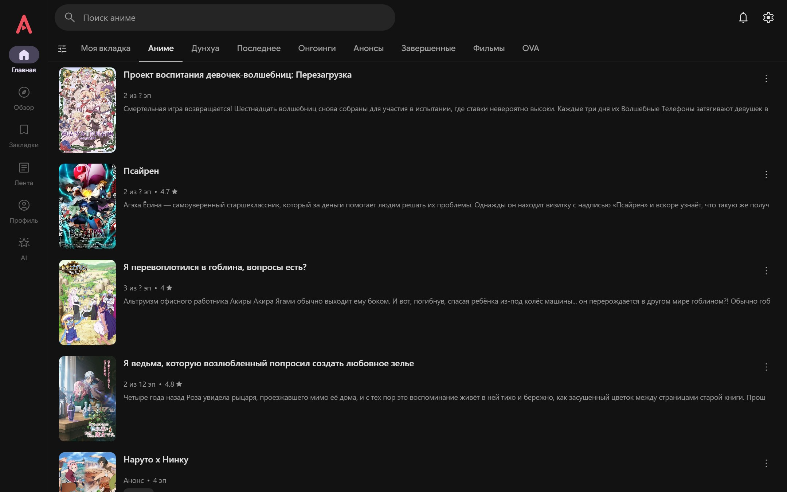
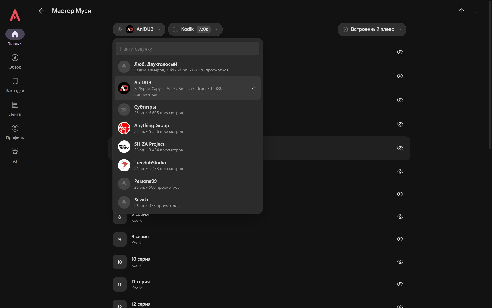
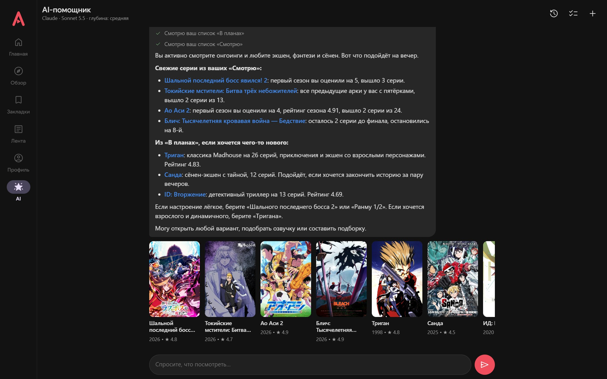

<div align="center">



# Anix Desktop

**Неофициальный клиент [Anixart](https://anixart.tv) для Windows и браузера — с AI-помощником на Claude**

[](https://github.com/arigandores/anix-desktop/releases/latest)
[](https://github.com/arigandores/anix-desktop/releases)
[](#скачать)
[](LICENSE)

[**Скачать**](https://github.com/arigandores/anix-desktop/releases/latest) · [Возможности](#возможности) · [AI-помощник](#ai-помощник) · [Запуск из исходников](#запуск-из-исходников)



</div>

Каталог, аккаунт, списки, комментарии и уведомления — с серверов Anixart; видео — из тех же источников,
что и в мобильном приложении (Kodik, Sibnet, VK, RuTube, AniLibria и др.).

<table>
  <tr>
    <td></td>
    <td></td>
  </tr>
</table>

> Anix Desktop — независимый проект: он не связан с разработчиками Anixart и не одобрен ими.
> Названия и товарные знаки принадлежат их правообладателям (см. `NOTICE.md`).

## Скачать

Готовые файлы — в разделе **Releases**:

| Файл | Что это |
|---|---|
| `AnixDesktop-Setup-1.2.1.exe` | установщик: ярлыки на рабочем столе и в «Пуске», можно выбрать папку |
| `AnixDesktop-Portable-1.2.1.exe` | один файл, запускается без установки |

Установщик не подписан — Windows SmartScreen может предупредить: «Подробнее» → «Выполнить в любом случае».
Размер Windows-сборок в основном — встроенный Claude Code (`claude.exe`) для AI-помощника.

**Версия для браузера** — архив «Source code» того же релиза: нужен Node.js 18+, распакуйте и запустите
`start-browser.bat` → http://127.0.0.1:8371/. Источники Kodik, VK Видео и StudioMir в ней работают только
с ключами (см. «Ключи сторонних сервисов»); из соцсетей доступен только Google, AI-помощник — после `npm install`.

## Запуск из исходников

```
npm install
npm run app        Windows-приложение (Electron)
npm start          версия для браузера (http://127.0.0.1:8371/)
```

Новые версии npm не запускают install-скрипты без разрешения. Если после `npm install` нет
`node_modules/electron/dist/electron.exe`, выполните `npm install-scripts approve electron` и повторите `npm install`
(или `node node_modules/electron/install.js`).

### Ключи сторонних сервисов

Ключи источников видео и входа через соцсети в репозитории не хранятся. Без них приложение работает,
но недоступны:

| Ключ (`config.example.json`) | Без него |
|---|---|
| `kodik.token` | источник Kodik (основной для большинства релизов) |
| `studiomir.apiKey` | источник StudioMir |
| `vkVideo.clientId`, `vkVideo.clientSecret` | источник VK Видео |
| `social.*` | вход через Google, Telegram, VK, Яндекс (кнопки скрываются) |

Скопируйте `config.example.json` в `config.local.json` (он в `.gitignore`) и заполните нужные поля.
Сервер ищет конфиг по порядку: путь из `ANIX_CONFIG` → `config.local.json` в корне → `~/.anixart-desktop/config.json`.
Готовые сборки из Releases уже содержат конфиг — там всё работает сразу.

## Возможности

Все основные разделы: Главная (вкладки и «Моя вкладка» с фильтром), Обзор, Закладки, Лента и каналы, Профиль, релиз,
озвучки и серии, поиск, фильтр, коллекции, комментарии и ответы, уведомления, вход/регистрация/восстановление, настройки.

- **Плеер**: встроенный (HLS), веб-плеер и сторонний (mpv/VLC); двойной клик по краю ±10 с с накоплением,
  удержание — скорость ×2 от текущей (1.25 → 2.5x), перемотка опенинга, автовоспроизведение, диалог
  «Начать сначала / Продолжить», реклама Kodik с автозапуском.
- **Настройки как в мобильном приложении**: «Запоминать вариант и источник»; «Непроверенные источники» и экран
  «Онлайн просмотр» (подтверждение поиска, «Запомнить?» после нескольких переходов); «Альтернативное соединение»
  (зеркала статики, API и плеера — `mirror-s.anixmirai.com` и т. п.); «Режим экономии ресурсов» (без анимаций);
  «Очистить веб-кэш»; тема, вид списков, качество, плееры.
- **Скорость интерфейса**: скелетоны вместо спиннеров на всех экранах (у каждого экрана свой — в той же
  раскладке, что и контент); релиз, канал, запись и коллекция открываются мгновенно с данными карточки
  (`preload`), остальное догружается; предзагрузка релиза, когда курсор остановился на карточке.
- **Как в мобильном приложении**: ЛКМ + движение прокручивает списки (а не выделяет текст), плавные переходы
  между экранами, у каждой вкладки свой стек экранов с сохранением прокрутки.
- **Вход через соцсети**: Яндекс, ВКонтакте, Telegram, Google — см. ниже.
- **AI-помощник** — отдельная вкладка, см. ниже.

## AI-помощник



Вкладка **AI** (шестая в меню) — чат с Claude, который видит аккаунт Anixart и помогает выбрать, что посмотреть,
а по просьбе сам меняет закладки, оценки и коллекции.

**Вход.** По порядку: аккаунт Anixart → аккаунт Claude (подписка Pro/Max или Anthropic Console — откроется окно
входа) → чат. Вход в Claude общий с Claude Code (`~/.claude`): если вы уже вошли там, повторять не нужно.
Запросы расходуют лимиты вашей подписки Claude.

**Что умеет** (`public/js/ai-tools.js`):

| Группа | Инструменты |
|---|---|
| Каталог | `search_releases`, `filter_releases` (жанры, год, статус, серии, «исключить мои списки»…), `get_genres`, `get_release`, `get_voiceovers`, `get_trending`, `get_schedule`, `get_recommendations` |
| Аккаунт | `get_my_list` (Смотрю / В планах / Просмотрено / Отложено / Брошено / Избранное), `get_history`, `get_my_profile`, `get_my_votes` |
| Изменения | `set_list_status`, `set_favorite`, `rate_release` |
| Коллекции | `get_my_collections`, `get_collection`, `create_collection`, `edit_collection`, `add_to_collection`, `remove_from_collection`, `delete_collection` |
| Экран | `open_release`, `open_episodes`, `open_collection` |
| Память | `remember`, `update_memory`, `forget` |
| Интернет | `WebSearch`, `WebFetch` (новости, отзывы) |

Изменения помощник делает сразу, когда пользователь просит, без подтверждений; без просьбы ничего не меняет
(так задано в системном промпте). Упомянутые релизы показываются в чате карточками с постерами.

**Память** — `~/.anixart-desktop/ai/memories/<id аккаунта>.md`, обычный Markdown (можно править руками).
Помощник сам записывает устойчивые предпочтения (жанры, формат просмотра, явные «запомни»); в начале каждой
беседы файл целиком попадает в системный промпт. Чтобы память не съедала контекст, она жёстко ограничена:
40 записей по 200 символов, не больше 4000 символов (≈1–1,5 тыс. токенов). При переполнении `remember`
отказывает и просит сначала объединить или удалить записи — память сжимает сам помощник.
Посмотреть, удалить запись или очистить всё — кнопка «Память» в шапке чата.

**История бесед** — кнопка «История»: до 30 бесед на аккаунт, возврат к беседе восстанавливает и контекст
агента (`session/load`). **«+»** — новая беседа, **«Стоп»** — прервать ответ.

**Модель и глубина рассуждений** — «Настройки → AI-помощник»: по умолчанию **Sonnet 5.5** и effort **medium**;
можно выбрать Opus 5.5, Haiku 5.5, Fable 5.1 и effort от low до max. Смена применяется и к текущей беседе.

**Как устроено**:

```
фронтенд ──POST /ai/*, SSE /ai/events──► server/ai.js ──ACP (stdio)──► claude-agent-acp ──► claude.exe
claude.exe ──MCP (HTTP) /mcp/<ключ>──► server/ai.js ──SSE──► фронтенд выполняет инструмент ──POST /ai/tool-result
```

- Агент — [`@agentclientprotocol/claude-agent-acp`](https://github.com/agentclientprotocol/claude-agent-acp)
  (Agent Client Protocol) со встроенным `claude.exe` из `@anthropic-ai/claude-agent-sdk-win32-x64`.
  Запускается через Electron как Node (`ELECTRON_RUN_AS_NODE`), отдельный Node.js не нужен.
- Инструменты Anixart выполняются во фронтенде (там токен, готовые вызовы API, локальная история, навигация);
  сервер только ретранслирует вызовы. Память обрабатывается на сервере (`server/ai-memory.js`).
- Ограничения агента: из встроенных инструментов Claude Code — только поиск в интернете; рабочая папка —
  пустая `~/.anixart-desktop/ai`; ваши настройки, `CLAUDE.md`, хуки и MCP из `~/.claude` не подключаются
  (`settingSources: []`, `strictMcpConfig`); режим разрешений ручной, инструменты приложения разрешены списком.
- Работает в Windows-приложении и при запуске из исходников после `npm install` (в т. ч. в браузере). Без
  установленных зависимостей (архив «Source code» как есть) вкладка сообщит, что помощник недоступен.

## Как устроено

```
server/            локальный Node-сервер
  index.js         /api/* → бекенд Anixart (повторы при сбоях); /parse → парсеры; /stream → медиа-прокси
                   (Range, Referer/Cookie, перезапись m3u8); /external → mpv/VLC; /social/* → соцвход
  sign.js          заголовки, которые бекенд ожидает от клиента: User-Agent, Sign, X-Codec-Profile, X-Media-Session
  config.js        ключи сторонних сервисов из config.local.json; /__features — что доступно в сборке
  parsers/         парсеры источников: Kodik, Sibnet, SovetRomantica, Mail.ru, Myvi, Allvideo,
                   AniLibria, StudioMir, VK, RuTube, OK
  social.js        Telegram (PKCE), VK ID, Яндекс, Google (Firebase)
  ai.js            AI-помощник: claude-agent-acp по ACP, /ai/*, MCP-ретранслятор /mcp/*
  ai-memory.js     memories.md: лимиты, инструменты remember / update_memory / forget
public/            SPA без сборки
  js/api.js        эндпоинты бекенда, разворачивание ссылок @id, зеркала, предзагрузка релиза
  js/router.js     стеки экранов по вкладкам; registerScreen(name, factory, skeleton)
  js/ui.js         UI-примитивы, скелетоны, бесконечные списки
  js/player.js     встроенный плеер, веб-плеер, реклама Kodik
  js/ai-tools.js   инструменты AI-помощника (описание + реализация)
  js/dragscroll.js прокрутка перетаскиванием
  js/screens/      экраны (ai.js — вкладка AI)
  icons/, fonts/, strings.json   иконки (Material Symbols, Simple Icons), шрифт Google Sans, строки интерфейса
electron/          окно приложения, окно рекламы Kodik, окна соцвхода, очистка веб-кэша
build/             иконка (icon.svg → make-icons.js) и сборка релиза (release.js)
test/              тесты (см. ниже)
```

## Вход через соцсети

- **Яндекс, ВКонтакте, Telegram** (только Windows-приложение): официальная страница провайдера открывается
  в окне приложения, оно перехватывает `redirect_uri`, и токен отправляется на бекенд Anixart (`auth/<провайдер>`).
- **Google** (Windows-приложение и браузерная версия): во встроенных окнах Google вход запрещает, поэтому
  открывается обычный браузер со страницей `http://localhost:<порт>/google-auth.html`. Она входит через
  Firebase и возвращает токен в приложение.

Нужны ключи `social.*` в конфиге (см. «Ключи сторонних сервисов»). Вход по логину и паролю работает везде.

## Где хранятся данные

- **localStorage окна приложения** (`%APPDATA%\Anix Desktop`): вход в Anixart, настройки, локальные отметки серий
  и позиции, история поиска, беседы AI (`anixart.ai.chats.<id>`).
- **`~/.anixart-desktop/ai/`**: рабочая папка AI-агента и `memories/<id>.md` — память помощника.
- **`~/.claude/`**: вход в Claude (общий с Claude Code) и сессии агента — по ним восстанавливаются беседы.

## Проверка

Тесты запускаются в скрытом окне Electron против живого бекенда Anixart (`npx electron test/<файл>.js`).
Тесты `ai-*` требуют входа в Claude на машине и расходуют немного лимитов; вход в Anixart в них фиктивный,
а изменяющие запросы к бекенду в `ai-actions` подменены — реальный аккаунт не затрагивается.
Тесты Kodik требуют `kodik.token` в конфиге.

```
npm test               smoke.js: API, Sign, парсер Kodik, m3u8 и сегменты (Node, без Electron)
npm run test:e2e       e2e.js: обход экранов со скриншотами, ошибки консоли
npm run test:ui        ui-audit.js (непереведённые строки), contrast.js (видимость элементов в обеих темах),
                       skeleton-match.js (скелетон ↔ контент по каждому экрану, снимки рядом)
                       layout-audit.js (ничего не вылезает за границы: экраны и диалоги на ширине 1280/820/420)
npm run test:ai        вся AI-часть (ниже)
```

| Файл | Что проверяет |
|---|---|
| `settings-flow.js` | «Непроверенные источники», «Альтернативное соединение» (постер с зеркала), режим экономии |
| `release-timing.js` | открытие релиза: шапка из preload и полная страница, скриншоты скелетона |
| `prefetch-spam.js` | предзагрузка не спамит: проход курсором и прокрутка — 0 запросов, остановка — 1 |
| `proxy-retry.js` | повторы прокси на поддельном бекенде (502, обрыв), POST не дублируется |
| `player-ind.js`, `resume.js`, `kodik-ad.js` | индикаторы плеера, «Начать сначала / Продолжить», автозапуск рекламы Kodik |
| `ai-chat.js` | ступени входа, ответ со ссылками и карточками релизов |
| `ai-stream.js` | стриминг без мигания: сообщение не пересоздаётся, поле ввода не двигается |
| `ai-actions.js` | закладка и коллекции (создать, убрать релиз) без подтверждений |
| `ai-memory.js` | «запомни» → memories.md → новая беседа помнит; история и возврат к беседе |
| `ai-config.js` | модель и effort по умолчанию и смена из настроек в текущей беседе |
| `ai-scroll.js` | прокрутка чата после перехода на релиз и «Назад» |
| `ai-away.js` | ответ дорисовывается, если во время него уйти на другой экран |
| `ai-stop.js` | «Стоп» сразу освобождает чат, следующий вопрос работает |

## Сборка и релиз

```
npm run build:win        портативная папка release\win-unpacked
npm run build:installer  установщик и portable-exe в release\
npm run build:release    файлы релиза в release\: установщик и portable-exe
```

`config.local.json`, если он есть, попадает в сборку; `node build/release.js --no-keys` — собрать без него.
Иконка: `build/icon.svg` → `npx electron build/make-icons.js` (icon.png, icon.ico, public/icon.png).

`node_modules` распаковываются из asar (`asarUnpack`): адаптер и `claude.exe` запускаются отдельным процессом
и не могут работать из архива.

## Star History

<a href="https://star-history.com/#arigandores/anix-desktop&Date">
  <picture>
    <source media="(prefers-color-scheme: dark)" srcset="https://api.star-history.com/svg?repos=arigandores/anix-desktop&type=Date&theme=dark">
    
  </picture>
</a>

## Лицензия

Код — [MIT](LICENSE). Шрифт, библиотеки и товарные знаки — см. [NOTICE.md](NOTICE.md).
